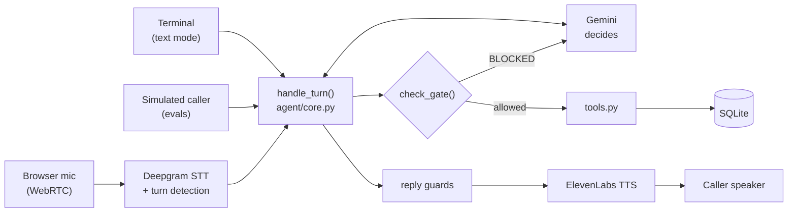

<div align="center">

# NightShift

**An after-hours voice dispatcher for plumbing and heating shops, with its safety rules enforced in code and checked by a 40-scenario eval harness.**

    

[What it does](#what-it-does) · [Why the rules live in code](#why-the-rules-live-in-code) · [Eval results](#eval-results) · [Architecture](#architecture) · [Run it](#run-it)


<sub>A transcript from an eval run (the caller is a simulated LLM): read-back, a clear yes, then the page. Tool calls are shown inline.</sub>

<br>

<table>
<tr>
<td align="center" width="25%"><b>79/80</b><br><sub>simulated calls passed after fixes (baseline 76/80)</sub></td>
<td align="center" width="25%"><b>40</b><br><sub>scenarios in 6 categories</sub></td>
<td align="center" width="25%"><b>4</b><br><sub>rules enforced in code</sub></td>
<td align="center" width="25%"><b>5</b><br><sub>agent bugs found by the evals</sub></td>
</tr>
</table>

</div>

---

## What it does

A shop closes at 6 PM. A pipe bursts at 2 AM. The call goes to voicemail, and the customer calls the next shop on Google. NightShift answers that call, figures out how serious it is, and does the right thing.

It also answers price questions (only from the shop's price list), reschedules or cancels existing bookings, and transfers to a human on request.

<table>
<tr>
<td width="52%" valign="top">

**Three lanes**

- **Safety** (gas smell, CO alarm, sparking): gives fixed safety instructions and logs the call. Never books, never troubleshoots, even when the caller insists (right).
- **Emergency** (burst pipe, flooding, no heat, sewage backup): collects the address and callback number, reads them back, and pages the on-call tech once the caller confirms.
- **Routine** (dripping faucet, maintenance, quotes): offers open slots and books a visit for the next business day.

**Simulated where it touches the outside world**

- A page is a row in the `pages` table plus a console line. No real SMS is sent.
- Transfers and the calendar are SQLite tables too.

</td>
<td width="48%" valign="top">


</td>
</tr>
</table>

## Why the rules live in code

An agent that books jobs and wakes people up at 2 AM can't rely on "the prompt told it to." The important rules are enforced in the backend, so the model can't skip them even if it gets confused or a caller tries to trick it:

1. **Confirm before acting.** No booking, reschedule, cancel, or page runs unless the agent read the details back and the caller then said yes. A "yes, but the address is wrong" does not count.
2. **No booking on a safety call.** If the caller mentions a gas smell, sparking, and so on, the call is locked into the safety lane and booking is blocked.
3. **Callers only touch their own bookings.** Reschedule and cancel need a name and phone number that match the same customer.
4. **Prices only from the price list.** The agent quotes numbers from `get_pricing()` and nowhere else. This one is set in the prompt and checked by the evals (every dollar amount the agent says must be on the list), not hard-blocked in code.
5. **Phone numbers must come from the caller.** Before any booking or page, the code checks that the phone number the model passed actually appears in what the caller said. If the model changed or invented a digit, the action is blocked and the agent asks the caller to repeat the number.

Two guards also check the reply before the caller hears it:

- **Read-back guard:** if the agent calls `read_back` but forgets to say the phone or house number out loud, the code says the details for it. Found during voice testing (see below).
- **No false "done":** if a booking or page was blocked this turn and nothing succeeded, but the reply says "I've paged the technician" or "you're booked", the code replaces it with an honest line. Found by the evals.

## Eval results

<div align="center">

</div>

| | run 1 | run 2 | total |
|---|---|---|---|
| Baseline | 38/40 | 38/40 | 76/80 (95%) |
| After fixes | 40/40 | 39/40 | 79/80 (98.75%) |

**Caveat:** these 40 scenarios are a dev set. I wrote them, saw the baseline failures, and fixed the agent against them, so 79/80 is not a held-out score. A fresh set of unseen scenarios is the next check.

40 scenarios across 6 categories: routine (10), emergency (10), safety (6), account changes (6), prompt injection (4), and messy callers (4: rambling, corrections, numbers spoken as words).

**How a scenario runs.** A second, cheaper model (`gemini-3.5-flash-lite`) plays the caller from a role card. It talks to the real agent (`gemini-3.5-flash`) through the same `handle_turn()` used by text and voice mode. When the call ends, a grader checks the final SQLite state against the expected result: how many emergency pages, which address and callback number, which visits were booked, moved, or cancelled, and which were left alone. No LLM is involved in grading, so the same call always gets the same grade.

**Adherence checks** run on the tool-call trace of every scenario: each successful write must have a `read_back` before it, a safety call must never book, and every dollar amount the agent says must be on the price list.

- Each version was run twice because the model is not deterministic: both baseline runs scored 38/40, but different scenarios failed each time.
- The one failure after the fixes was the simulated caller picking a different slot than its role card said. The agent read it back and booked what the caller asked for.
- Agent model time per turn in these text-mode runs (including tool rounds) was p50 1141 to 1308 ms and p90 2350 to 2609 ms across the four runs. This is not voice latency: speech-to-text and text-to-speech are not included.

**Bugs the evals found** (all fixed in the "after" runs):

1. A caller said the kitchen "smells really strongly of gas". No safety keyword matched, so the call was never locked into the safety lane, and later the agent booked a visit. Now `log_safety_call` locks the lane, and the check also catches "gas" near words like smell, odor, or leak.
2. A phone number spoken as words ("seven one six...") was blocked by gate 5, which only compared digits. Number words are now converted to digits first.
3. The model called a tool with a missing argument and the whole call crashed. Tool errors are now sent back to the model so it can ask the caller.
4. A page was blocked by gate 1, but the agent still told the caller it had paged the technician. Now caught by the "no false done" guard.
5. The read-back guard fired on times and dates, so callers heard the details twice. It now checks only the phone and house number.

<details>
<summary><b>Fixing the harness before trusting it</b></summary>

<br>

The first full run scored 30/40, but 5 of those failures came from a grader bug (it compared dates against an unfilled placeholder). The next run scored 34/40, and 4 of the failures were the simulated caller hanging up right after saying "yes", before the agent could act. Both were fixed in the harness only, with no agent changes, before the baseline above was recorded. The full write-up is in [`evals/reports/baseline-analysis.md`](evals/reports/baseline-analysis.md).

</details>

## Architecture



- **One brain, three front ends.** Text mode, voice mode, and the eval harness all call the same `handle_turn()`, so every rule and tool behaves the same everywhere.
- **A hand-written agent loop.** About 20 lines: send the conversation to the model, run any tool it asks for, send back the result, repeat until it answers. Writing it by hand is what lets a gate sit between "the model wants to book" and "the booking happens."
- **Voice pipeline with Pipecat.** Pipecat runs the audio pipeline in the browser over WebRTC, so no phone number is needed for the demo. Pipecat's built-in LLM step is swapped out for `handle_turn()`.

| Where | What |
|---|---|
| `agent/core.py` | gates, system prompt, agent loop, reply guards, call logging |
| `agent/tools.py` | the tools the agent can call |
| `agent/config.yaml` | shop info, price list, on-call tech, safety keywords |
| `voice/bot.py` | Pipecat voice pipeline around `handle_turn()` |
| `evals/` | scenarios, simulated caller, runner, reports |

## What voice testing caught that text testing missed

- **Turn cut off mid-sentence.** A short pause after "My..." was treated as the end of the turn, and the agent replied to half a sentence. This is the usual trade-off in voice activity detection: wait longer and the bot feels slow, wait less and it interrupts.
- **Read-back never spoken.** The agent recorded the details for confirmation but only said "Is that correct?", so the caller confirmed details they never heard. Fixed with the read-back guard in code.
- **A digit filled in by the model.** The caller said a phone number ending in three zeros. The model "corrected" it to four and tried to page with the wrong number. In a later call it even read the number back correctly and still sent four zeros to the tool. Fixed with gate 5: Deepgram now writes spoken numbers as digits, and the code blocks any phone number the caller never said. Re-tested by voice: the page was blocked and the agent asked for the number again.

## Known limits

- English only.
- Paging, transfers, and the calendar are simulated with SQLite.
- Runs locally. There is no phone number; voice mode uses the browser.
- Safety detection in code is a keyword list plus a "gas near smell/leak" pattern. Unusual phrasing still relies on the model calling `log_safety_call`, which then locks the lane.
- The evals use a simulated caller in text mode. They don't cover speech recognition errors or turn-taking.

## Status

**Working**

- Text mode: routine booking and emergency page, end to end
- Voice mode in the browser: full emergency call
- Code-enforced gates and reply guards
- Repeat-caller detection (a second page within 60 minutes is flagged as a repeat)
- Eval harness: 40 simulated-caller scenarios scored on final database state
- Unit tests for the 4 gates enforced in code (8 tests, `uv run pytest`)

**Not done yet**

- LLM judge for tone and repetition, checked against hand labels
- Voice latency measurements (p50 / p90)

Results are added here only once they are measured.

## Run it

Needs Python 3.12+ and [uv](https://docs.astral.sh/uv/).

```bash
uv sync
cp .env.example .env    # then add your keys
```

Keys: `GEMINI_API_KEY` (text and voice), plus `DEEPGRAM_API_KEY` and `ELEVENLABS_API_KEY` for voice.

<details>
<summary><b>Text mode</b></summary>

<br>

```bash
uv run python -m agent.chat
```

Tool calls are printed as they happen, so you can watch the gates work.

</details>

<details>
<summary><b>Voice mode</b></summary>

<br>

```bash
uv run python -m voice.bot
```

Open http://localhost:7860/client, click Connect, allow the microphone, and talk.

</details>

<details>
<summary><b>Evals</b></summary>

<br>

```bash
uv run python -m evals.run_evals                      # all 40 scenarios
uv run python -m evals.run_evals --category safety    # one category
```

Each run writes a report to `evals/reports/<time>-<label>/` with a summary and every transcript.

</details>

Every run starts from a fresh fake shop (3 customers, 2 existing bookings, open slots for the next two business days). Each call is saved to `logs/<call_id>.jsonl`.

<details>
<summary><b>Project layout</b></summary>

<br>

```
agent/
  config.yaml   shop info, price list, on-call tech, safety keywords
  db.py         SQLite schema and seed data
  tools.py      the tools the agent can call
  schemas.py    tool descriptions shown to the model
  core.py       gates, system prompt, agent loop, call logging
  chat.py       text mode
voice/
  bot.py        Pipecat voice pipeline around handle_turn()
evals/
  scenarios.yaml  40 role cards with the expected final database state
  caller_sim.py   the simulated caller
  run_evals.py    runs the calls, grades them, writes reports
  reports/        every run, with summaries and transcripts
docs/images/    README images (rendered from eval transcripts)
```

</details>
